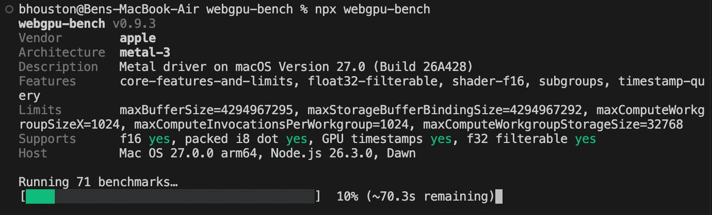
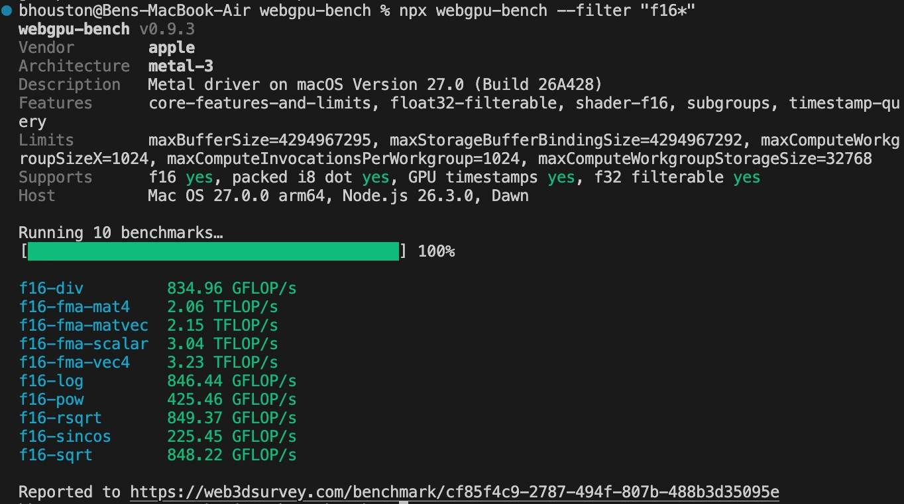
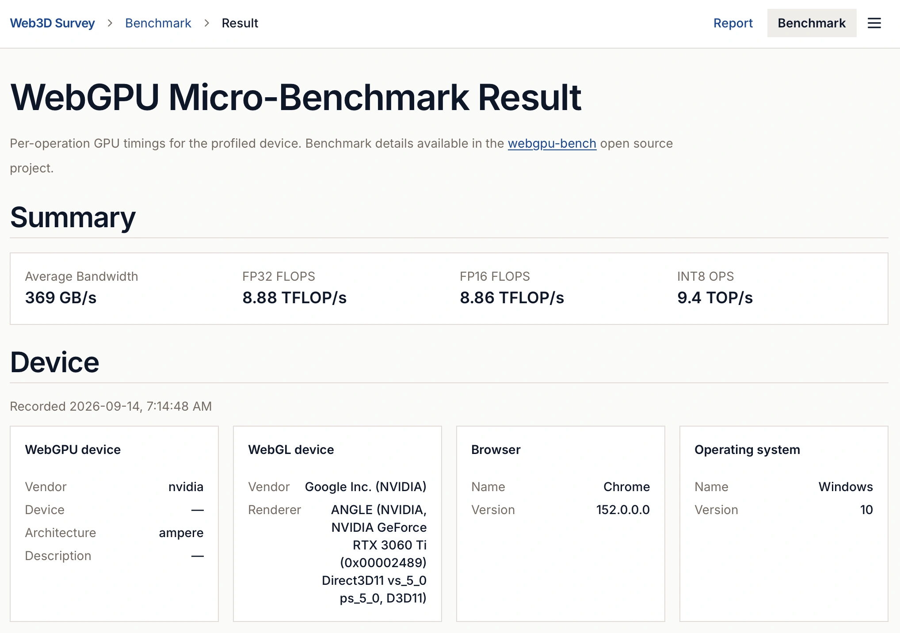

<p align="center">
  <a href="https://npmjs.com/package/webgpu-bench"></a>
  <a href="https://www.npmtrends.com/webgpu-bench"></a>
  <a href="https://codecov.io/gh/bhouston/webgpu-bench"></a>
  <a href="https://discord.gg/fwupDN493R"></a>
</p>
<br/>

# webgpu-bench

> Microbenchmarks for WebGPU: measure what your GPU can really do.

- 📊 Memory Bandwidth Probes
- 🧮 fp32, fp16 and int8 FLOPS
- 🔬 Shader Technique Comparisons
- 💻 CLI Without a Browser
- 🌐 Browser Benchmark Library
- 🌡️ Thermal Throttle Detection

A microbenchmark suite for WebGPU: it isolates and benchmarks a device's raw ceilings (memory
**bandwidth** (read/write) and **FLOPS** (fp32, fp16, int8; scalar/vec4/mat4/matvec)) one operation at a
time in the browser, plus fixed-work comparisons of shader techniques such as layouts, workgroup sizes,
reductions, and atomic aggregation. It is not a full app or game benchmark.

This is a **micro-benchmark**, not a game or app benchmark: it tells you the raw cost of specific
operations (a memory read, an fp32 FMA, an int8 dot product, a divergent branch) on _your_ GPU, so you can
make better-informed decisions when writing shaders, and understand how those costs differ across
devices. Use it as a CLI or as a library embedded in your own tools.

Try it live on the [Web3D Survey: GPU Benchmark page](https://web3dsurvey.com/benchmark). Read the
[announcement post](https://ben3d.ca/blog/introducing-webgpu-bench).

## Packages

| Package                            | Version (click for changelogs)                                                                                                                  |
| ---------------------------------- | :---------------------------------------------------------------------------------------------------------------------------------------------- |
| [webgpu-bench](packages/cli)       | [](https://github.com/bhouston/webgpu-bench/releases)           |
| [webgpu-bench-core](packages/core) | [](https://github.com/bhouston/webgpu-bench/releases) |

- `webgpu-bench` is the command-line runner (WebGPU via Dawn, no browser needed). See its [README](packages/cli/README.md).
- `webgpu-bench-core` is the benchmark suite (WGSL shaders, data generation, timing harness, orchestration).
  Framework-agnostic, browser-only, consumed as TypeScript source. See its [README](packages/core/README.md).

## Screenshots





## Development

Follow [CONTRIBUTING.md](CONTRIBUTING.md) for the issue, branch, PR, and release workflow.
See [release setup](docs/releases.md) for npm trusted publishing.

```bash
pnpm install
pnpm exec playwright install chromium webkit
pnpm build
pnpm lint
pnpm tsc
pnpm test
pnpm test:workflow
pnpm audit --audit-level high
pnpm size
```

The default test command runs Chromium, Node, and CLI tests with coverage, then enforces a coverage gate.
WebKit is a separate advisory CI job; `pnpm test:all` runs all projects locally.

```bash
pnpm --filter webgpu-bench-core test:browser   # Both browsers (macOS with WebGPU)
pnpm --filter webgpu-bench-core test:chromium # Chromium only
pnpm --filter webgpu-bench-core test:webkit   # WebKit only
```

### Coverage and size budgets

Coverage covers all production TypeScript in both packages. CLI subprocess code isn't measured by
Vitest's in-process coverage; integration tests still exercise it. Thresholds are 75% for aggregate
statements, functions, and lines, and 70% for branches — raise them as coverage improves. Size Limit
measures compressed compiled JavaScript, with budgets of 100 kB for core and 20 kB for CLI (external
dependencies and native Dawn binaries are excluded).

Commit history predating conventional-commits adoption is not linted retroactively; the `policy` CI job
and the pre-commit hook only check new commits.

## Contribution

See [Contributing Guide](CONTRIBUTING.md).

## License

MIT

## Author

[Ben Houston](https://ben3d.ca), Sponsored by [Land of Assets](https://landofassets.com).
